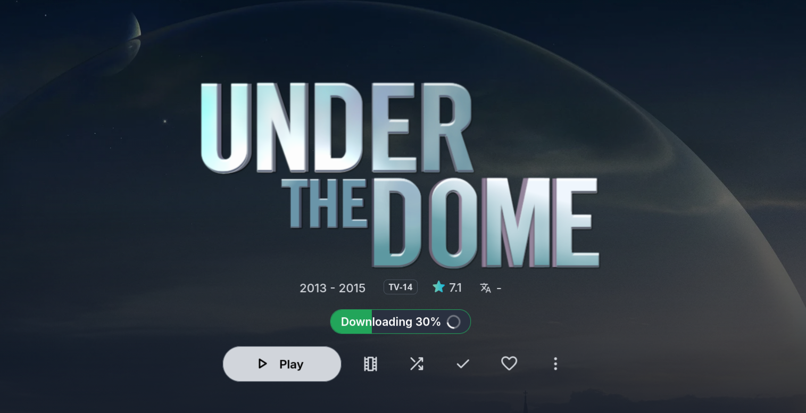
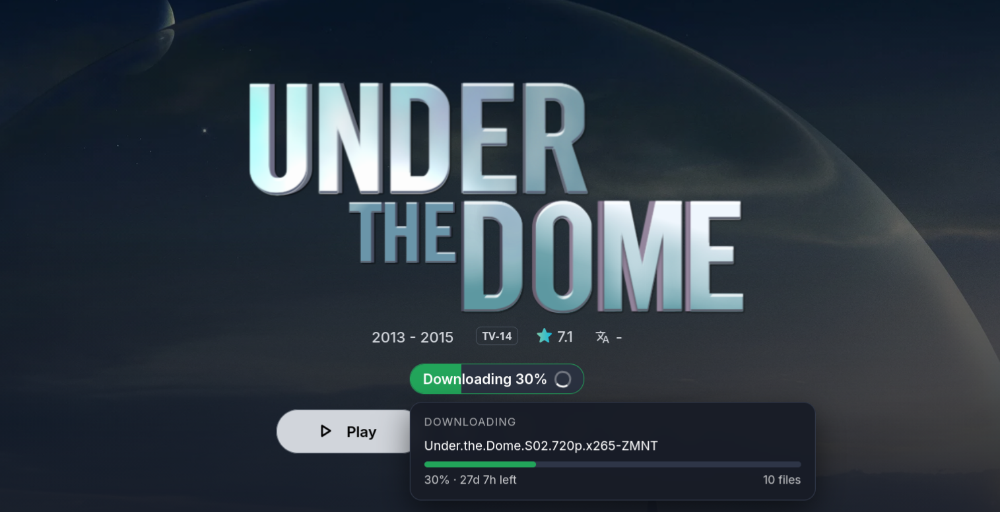

# Seerr Progress for Jellyfin

A Jellyfin plugin that shows **download progress from Seerr** right on the item page in Jellyfin. Open a series or movie that is currently downloading and a green progress pill appears. Hover over it (or tap it) for a small menu with a progress bar and time left per download.

Seerr only shows download progress inside Seerr. If Seerr is only reachable on your local network, your Jellyfin users can't see it. This plugin runs on the Jellyfin server, talks to Seerr from there, and shows the result inside Jellyfin. Users only need access to Jellyfin.

<p align="center">
  
  
</p>

## Features

- Progress pill ("Downloading 28%") on the series or movie page, matched by TMDB ID.
- Hover or tap menu with one entry per download: release name, progress bar, percentage, time left.
- Season packs are grouped into one entry (Sonarr lists a pack once per episode).
- **My requests tab:** every user sees their own Seerr requests with a status (waiting for approval, approved, downloading with a progress bar, available, declined, failed), including requests that are not in the library yet.
- Seerr stays private. The Seerr API key is stored on the Jellyfin server and never reaches the browser.
- Status endpoint is protected by Jellyfin login.
- Installs and updates from the Jellyfin plugin catalog by adding this repository.

Tested with **Jellyfin 12.2** and **Seerr 3.4.1**.

## How it works

```
Browser ──(Jellyfin login)──> Jellyfin plugin ──(API key)──> Seerr ──> Radarr / Sonarr ──> qBittorrent
```

1. The plugin exposes `GET /SeerrProgress/Status`, which requires a logged-in Jellyfin user.
2. On request, it calls Seerr's `/api/v1/request?filter=processing`, reads `downloadStatus` for each media item, and returns the progress per TMDB ID. Results are cached for 4 seconds.
3. A small script (`client.js`) loads in the Jellyfin web UI, finds the TMDB ID of the page you're on, and draws the pill and menu. It refreshes every 5 seconds.
4. For the requests tab, `GET /SeerrProgress/Requests` takes the user from the Jellyfin login (not from a parameter), finds the matching Seerr user, and returns only that user's requests with titles, posters and status.

## Requirements

- Jellyfin 12.x (.NET 10). Jellyfin 10.11 builds are not provided, see [Other Jellyfin versions](#other-jellyfin-versions).
- Seerr reachable from the Jellyfin server, plus a Seerr API key (Seerr → Settings → General).
- Radarr and/or Sonarr connected to Seerr. Progress comes from their download queues.
- The [JavaScript Injector](https://github.com/n00bcodr/Jellyfin-JavaScript-Injector) plugin, to load the script into the web UI.

## Install

### Option 1: Add the plugin repository (recommended)

Jellyfin installs the plugin and handles updates for you. No building, no file copying.

1. In Jellyfin, open **Dashboard → Plugins → Repositories** and click **+**.
2. Fill in:
   - **Repository Name:** `Seerr Progress`
   - **Repository URL:**
     ```
     https://raw.githubusercontent.com/YOU/REPO/main/manifest.json
     ```
3. Save. Then open the **Catalog** tab, find **Seerr Progress** (category *General*), click **Install**, and restart Jellyfin.
4. Open **Dashboard → Plugins → Seerr Progress → Settings** and fill in:
   - **Seerr URL**: as the Jellyfin server sees it, for example `http://192.168.1.20:5055`.
   - **Seerr API key**.
5. Install the **JavaScript Injector** plugin from the catalog and restart Jellyfin. Then add a script with this content and turn on *Requires Authentication*:
   ```js
   import('/SeerrProgress/client.js');
   ```
   This step is needed because a plugin can't load its own script into the web UI.
6. Hard-refresh the browser (Ctrl+Shift+R) and open an item that is downloading.

When a new version is released, Jellyfin shows the update in **Dashboard → Plugins**. Update it there and restart Jellyfin.

### Option 2: Manual install

Use this if you want to build the plugin yourself or can't add the repository.

1. Build the plugin, see [Build from source](#build-from-source).
2. Create the plugin folder on the Jellyfin server and copy in the DLL and `meta.json`:

   ```bash
   mkdir -p /var/lib/jellyfin/plugins/SeerrProgress_1.1.0.0
   cp out/Jellyfin.Plugin.SeerrProgress.dll meta.json /var/lib/jellyfin/plugins/SeerrProgress_1.1.0.0/
   ```

   For a remote server, `scp` the files to a temporary folder first and move them into place on the server.

3. **Fix the ownership.** Jellyfin must be able to write to `meta.json`. If the files are owned by root, Jellyfin fails to start with `Access to the path '.../meta.json' is denied`.

   ```bash
   chown -R jellyfin:jellyfin /var/lib/jellyfin/plugins/SeerrProgress_1.1.0.0
   ```

   Run this after every update too.

4. Restart Jellyfin:

   ```bash
   systemctl restart jellyfin
   ```

   Docker users: put the folder under the `plugins/` directory of the volume mounted as `/config` and restart the container.

5. Continue with steps 4 to 6 of Option 1 (settings, JavaScript Injector, hard refresh).

A yellow "error occurred while getting the plugin details from the repository" banner on the plugin page is normal for manually installed plugins.

To update a manual install, rebuild, copy the DLL over the old one, run the `chown` from step 3, restart Jellyfin, and hard-refresh the browser. `client.js` is embedded in the DLL, so there is nothing else to copy.

### Optional: the "My requests" tab

The pill only appears on pages of items that are already in your library. The requests tab covers everything else: it lists the logged-in user's own requests, including ones that haven't been imported yet.

1. Install the **Custom Tabs** plugin from the catalog and restart Jellyfin.
2. In its settings, add a tab, for example titled `My Requests`, with this as the content:
   ```html
   <div id="seerr-requests"></div>
   ```
3. Hard-refresh the browser. The tab appears on the home screen and fills itself in.

The script fills in the `seerr-requests` element wherever it is on screen, so any other plugin that can show HTML works too.

Each user needs a Seerr account linked to their Jellyfin account, which happens when they log in to Seerr with their Jellyfin login (or an admin imports the users). Users without one see a message telling them so.

Clicking a request that is available, partly available or downloading opens its page in Jellyfin.

## Build from source

Only needed for the manual install or for development. Requires the .NET 10 SDK.

```bash
dotnet publish -c Release -o out
```

The plugin DLL ends up at `out/Jellyfin.Plugin.SeerrProgress.dll`.

No SDK installed? Build in a container:

```bash
podman run --rm -v "$PWD":/src:Z -w /src mcr.microsoft.com/dotnet/sdk:10.0 dotnet publish -c Release -o out
```

(Use `docker` and drop `:Z` if you don't use Podman with SELinux.)

## Limitations

- **Delay.** The numbers come from Seerr, which gets them from Sonarr/Radarr's queue. They trail your torrent client by a short while. The plugin itself adds only a few seconds.
- **Seerr requests only.** Downloads that were not requested through Seerr don't show up.
- **Pill: items in your library only.** The pill is drawn on an item's page, which only exists once something has been imported. Use the requests tab for requests with nothing imported yet.
- **Requests tab: latest 50.** It shows each user's 50 most recent requests.
- **Per-season status is approximate.** When a show has several season requests, a season request shows "Downloading" if anything for that show is downloading.
- **TMDB ID required.** The Jellyfin item needs a TMDB ID, which the default metadata providers set.
- **UI selectors.** The pill is placed next to the item's info row. If your theme or a Jellyfin update moves those elements, the pill falls back to a floating position in the bottom-left corner.

## Troubleshooting

| Problem | Check |
|---|---|
| Plugin doesn't appear in the catalog after adding the repository | Check that the repository URL opens in a browser and shows JSON. Then check that the `targetAbi` in `manifest.json` is not newer than your Jellyfin version. |
| Install from the catalog fails | The `checksum` in `manifest.json` must be the MD5 of the exact zip attached to the release. |
| Jellyfin won't start, log says `Access to the path ... meta.json is denied` | Manual install only. Run the `chown` from the manual install steps. |
| Plugin doesn't show up after install | Check the Jellyfin log for a version mismatch. The plugin targets Jellyfin 12.0 or newer (`targetAbi` 12.0.0.0). |
| No pill | Open `https://<jellyfin>/SeerrProgress/client.js` in the browser. If it loads, the plugin works and the script injection is the problem. |
| Still no pill | In the browser console run `ApiClient.getJSON(ApiClient.getUrl('SeerrProgress/Status')).then(console.log)`. `401` means the request isn't authenticated, `502` means Jellyfin can't reach Seerr (check URL and key), and `[]` means Seerr reports nothing in processing. |
| Requests tab is empty or shows "not linked" | The user needs a Seerr account linked to their Jellyfin account. Have them log in to Seerr once with their Jellyfin login. |
| Requests tab doesn't appear | Check that the Custom Tab content is exactly `<div id="seerr-requests"></div>` and hard-refresh. |
| Posters missing in the requests tab | Posters load straight from TMDB's image server in the browser. Check that the browser can reach `image.tmdb.org`. |
| Pill shows "Processing" with no percentage | Seerr has the request but no download info yet. Check the request in the Seerr UI. |
| Old behavior after an update | Hard-refresh the browser, and confirm the new version is installed in Dashboard → Plugins. |

## API

`GET /SeerrProgress/Status` returns the list of media currently processing:

```json
[
  {
    "tmdbId": 46331,
    "mediaType": "tv",
    "percent": 28.2,
    "items": [
      {
        "title": "Under.the.Dome.S02.720p.x265-ZMNT",
        "percent": 28.2,
        "timeLeft": "02:44:46",
        "status": "downloading",
        "count": 10
      }
    ]
  }
]
```

`GET /SeerrProgress/Requests` returns the logged-in user's own requests:

```json
{
  "configured": true,
  "linked": true,
  "requests": [
    {
      "id": 12,
      "type": "tv",
      "tmdbId": 46331,
      "title": "Under the Dome",
      "year": "2013",
      "poster": "/abc123.jpg",
      "state": "downloading",
      "percent": 28.2,
      "timeLeft": "02:44:46",
      "seasons": [2],
      "is4k": false,
      "requestedAt": "2026-10-19T08:00:00.000Z"
    }
  ]
}
```

`state` is one of `pending`, `approved`, `downloading`, `partial`, `available`, `declined`, `failed`.

`GET /SeerrProgress/client.js` serves the UI script. It needs no login because it is loaded with a plain `import()`, and it contains no secrets.

## Security notes

- The Seerr API key is saved in the plugin's configuration file on the Jellyfin server, in plain text, like other Jellyfin plugin settings. Anyone with access to that file can read it.
- The requests endpoint only returns the requests of the user who is logged in. The user comes from the Jellyfin auth token, so one user can't read another user's requests.
- Posters in the requests tab are loaded by the browser directly from TMDB's image server (`image.tmdb.org`), so TMDB sees those image requests.
- Use a Seerr URL on your internal network. Nothing about Seerr needs to be exposed.

## Other Jellyfin versions

This build targets Jellyfin 12 (.NET 10). For Jellyfin 10.11 you would change `TargetFramework` to `net9.0`, the `Jellyfin.Controller` package to `10.11.*`, and `targetAbi` in `meta.json` to `10.11.0.0`. This is untested.

## Releasing a new version (maintainers)

1. Bump the version in `SeerrProgress.csproj` and `meta.json`.
2. Build and zip the DLL, then get the MD5:
   ```bash
   dotnet publish -c Release -o out
   cd out && zip seerr-progress_X.Y.Z.W.zip Jellyfin.Plugin.SeerrProgress.dll
   md5sum seerr-progress_X.Y.Z.W.zip
   ```
3. Create a GitHub release with the tag `vX.Y.Z.W` and attach the zip:
   ```bash
   gh release create vX.Y.Z.W out/seerr-progress_X.Y.Z.W.zip --title "vX.Y.Z.W - Short description" --notes "What changed"
   ```
4. Add a new entry at the top of `versions` in `manifest.json` with the new `version`, `changelog`, `targetAbi`, `sourceUrl` (the release asset URL), `checksum` (the MD5 from step 2) and `timestamp`, then commit and push.

Don't re-zip the file after taking the MD5. A new zip usually has a different hash, and Jellyfin refuses to install a file whose hash doesn't match.

## Project layout

```
SeerrProgress.csproj           project file
Plugin.cs                      plugin entry point, config page registration
PluginConfiguration.cs         Seerr URL and API key settings
SeerrProgressController.cs     /SeerrProgress/Status and /SeerrProgress/client.js
Web/config.html                settings page
Web/client.js                  pill and hover menu in the web UI
meta.json                      plugin manifest for manual installs
manifest.json                  plugin repository manifest for the Jellyfin catalog
images/                        screenshots used in this README
```

## License

GPL-3.0. See [LICENSE](LICENSE).
